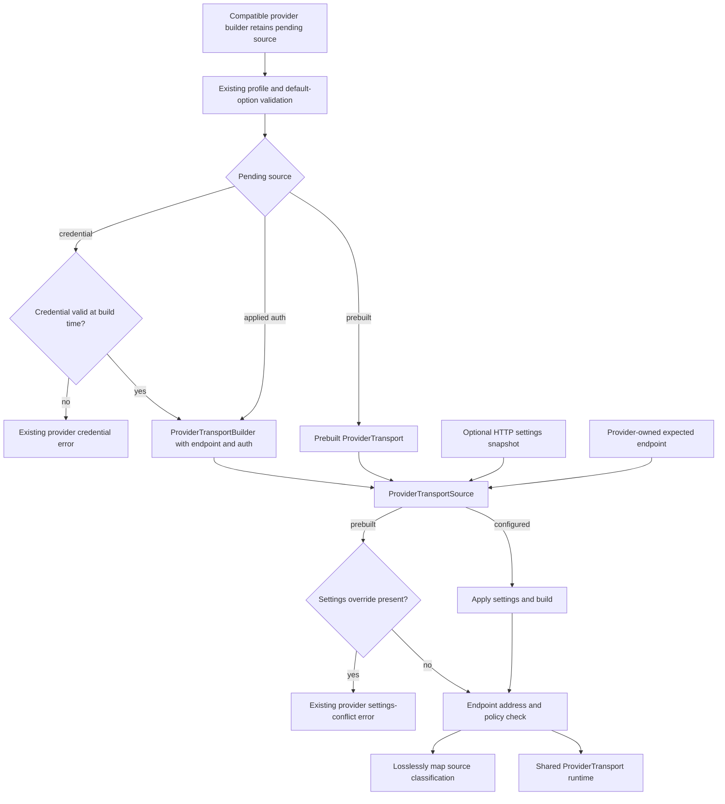
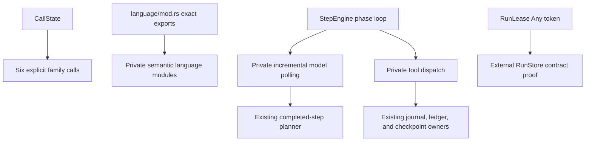
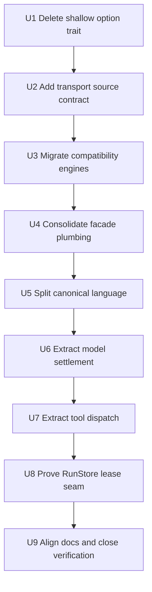

# Architecture Deepening and Provider Transport Assembly - Plan

## Goal Capsule

**Objective:** Preserve Siumai's typed public APIs and exact provider/runtime behavior while making provider transport setup, facade calls, canonical language contracts, and runtime step execution cheaper to change and safer to review.

**Means:** Introduce one narrow experimental transport-owned provider-author source contract, delete shallow validation indirection, consolidate only mechanical facade call plumbing, split large private language and runtime implementations by invariant, and retain the current `RunLease` representation unless external-store evidence disproves it (KTD1-KTD10).

**Authority hierarchy:** Product Requirements define observable compatibility and ownership. Key Technical Decisions define internal seams. Implementation Units define sequencing and file ownership without overriding either contract.

**Stop conditions:** Stop and surface a blocker if the work requires a universal provider builder, general middleware, provider credential types or callbacks inside transport, a new compatible-provider error variant, a changed provider error source chain, a workspace-wide protocol execution trait, public canonical-language type changes, merged runtime journal/checkpoint ownership, a non-object-safe `RunStore`, edits under `repo-ref/`, or live provider calls. Stop the transport milestone if both compatibility engines cannot share a source contract that deletes real transport-resolution logic without claiming to validate auth, resolver, retry-classifier, or provider identity.

**Execution profile:** This is a deep, serial Rust refactor. Breaking beta cleanup is permitted, but public breakage is not a target and must earn a direct deletion or correctness benefit. Reuse the workspace target directory, run Cargo serially, and keep all tests deterministic and offline.

**Tail ownership:** Implementation includes code, contract tests, architecture records, rustdoc, changelog alignment, simplification, and repository verification. It does not include pushing, publishing, or opening a pull request without separate authorization.

---

## Product Contract

### Summary

Siumai will deepen five existing internal boundaries without changing its product model.
The main change is a documented experimental `siumai-transport` provider-author contract that resolves either a configured transport builder or an address-and-policy-compatible prebuilt transport.
The two compatibility engines will use that contract and delete their duplicated settings interpretation, conflict handling, endpoint compatibility, and build helpers while retaining provider-owned pending credential state.

The facade, canonical language model, and runtime engine will keep their existing public ownership while moving mechanical or lifecycle-heavy implementation into private deep modules.
`OptionFields` will be deleted.
`RunLease` will receive an external adapter contract and clearer rustdoc, but its opaque `Any` token will remain unless the contract exposes a real failure.

### Problem Frame

Recent releases established the correct major owners: transport controls network safety and replay, providers control credentials and native semantics, the facade offers typed common calls, core owns canonical language contracts, and runtime owns multi-step execution.
The remaining maintenance pressure is now inside those owners rather than between them.

The OpenAI-compatible and Anthropic-compatible builders independently implement the same transport-source state machine.
`siumai-core::language` and `StepEngine` contain several stable semantic regions in single large files.
Facade family calls repeat public wrapper plumbing even though `CallState` already owns option and deadline assembly.
One small `OptionFields` trait adds indirection without owning a rule.

The local Vercel AI SDK checkout confirms the value of centralized common configuration and call preparation, but its dynamic middleware, fetch injection, and provider shape do not preserve Siumai's Rust ownership or transport guarantees.
This plan therefore uses AI SDK as prior-art evidence and not as a target architecture.

### Key Decisions

- **Execute all high-confidence deepening candidates as one coordinated plan, with provider-to-transport assembly as the main line.** (session-settled: user-approved — chosen over isolated cleanup only: the coordinated sequence can remove duplication while protecting the already accepted owners.) Governs R1-R18.
- **Preserve the current provider-direct, family-neutral, typed-facade ownership model.** (session-settled: user-approved — chosen over a universal client, provider builder, or middleware layer: those abstractions would move authority above the layer that can enforce it.) Governs R1-R6, R9-R14, R17.
- **Use the local AI SDK checkout only as secondary design evidence.** (session-settled: user-approved — chosen over architecture parity with AI SDK: Siumai must retain Rust-first types, explicit replay proof, and transport-owned safety.) Governs R2, R9, R14, R17.
- **Keep `RunLease` evidence-gated.** (session-settled: user-approved — chosen over removing `Any` for aesthetic consistency: the current opaque token preserves object safety and store-private lease authority.) Governs R15, R16.

### Requirements

#### Provider transport assembly

- R1. `siumai-transport` must own one narrow provider-author contract under an explicit experimental namespace for resolving a configured `ProviderTransportBuilder` or reusing a prebuilt `ProviderTransport`.
- R2. The contract must be single use and own HTTP settings interpretation, delayed prebuilt-settings conflict detection, endpoint address-and-policy compatibility, transport construction, and sanitized transport-source errors without performing network I/O.
- R3. Endpoint compatibility must preserve the current typed base URL and `EndpointPolicy` semantics, including normalization, path, query, trailing-slash, and default-port behavior, rather than weakening the check to raw strings, host, origin, model name, or another heuristic.
- R4. Provider crates must continue to own credential validation, conversion to `AuthApplier`, profile selection, endpoint choice, retry classification, replay declarations, provider identity, and mapping into provider-specific configuration errors.
- R5. The first consumers must be `siumai-openai-compatible` and `siumai-anthropic-compatible`; ordinary branded provider builders must not be migrated unless implementation proves that they contain the same configured-versus-prebuilt resolution problem.
- R6. Existing compatibility-engine constructors, repeated HTTP-settings setter behavior, validation order, configured-instance identity, public error discriminants, `Display`, and direct error sources must remain compatible.
- R7. A branded or composite provider that supplies a prebuilt transport must treat it as the sole transport authority and share the same runtime instance across compatible branches without rebuilding it or reapplying credentials, retry policy, redirects, settings, route, observer, or admission state.

#### Deletion and private deepening

- R8. The private `OptionFields` trait and boxed key iterator must be deleted while both default-option maps and typed provider-option maps retain identical protected-field validation and forward-compatible unknown fields. Raw call-option overlays remain codec-policy-owned and retain their existing reviewed-overlay or fail-closed behavior.
- R9. Facade family calls may share only mechanical wrapper plumbing; every family must retain explicit validation, diagnostic text, operation name, result type, limits, and terminal method behavior.
- R10. Each facade call must resolve its deadline once, validate the complete baseline-plus-provider-patch candidate before dispatch, preserve exact-model binding, and attach the existing route context to preflight failures.
- R11. `siumai-core::language` must be split into private semantic files while preserving every current `siumai_core::language::*` and root re-export, constructor, constant, error, serde shape, and wire behavior.
- R12. `StepEngine` must retain the phase enum, event queue, report and budget commits, and transition loop while incremental model-stream polling and settlement move behind one private state/outcome boundary.
- R13. Tool scheduling and attempt settlement must move behind a separate private context/outcome boundary while the existing journal, provider-deferred ledger, checkpoint writer, and completed-step planner remain independent owners.
- R14. The refactor must retain the OpenAI `extension::v2` execution kernel, separate buffered and streaming transport lifecycles, typed facade provider adapters, and provider-owned native capabilities.

#### Runtime store evidence and repository quality

- R15. `RunStore` must remain object safe, and an external contract test must prove through public APIs that a custom `dyn RunStore` can issue a private lease token through acquire, load, renew, compare-and-swap, and release.
- R16. `RunLease` must continue to keep its token store-private, reject foreign store or run identity, exclude the token from snapshots, journals, serialization, and diagnostics, and preserve existing internal fencing tests; no redesign is allowed without a failing external-adapter contract or a real storage-adapter requirement.
- R17. The implementation must add no general middleware, universal builder, cross-protocol execution trait, model-name heuristic, new duplicate type system, or facade re-export of the provider-author transport source.
- R18. Architecture documentation, ADRs, rustdoc, tests, and changelog entries must describe the final owners and remove references to implementation structures that no longer exist.
- R19. `repo-ref/ai` must remain read-only and must not become a dependency, published input, or source-layout template.

### Key Flows

- F1. **Managed compatible-provider construction**
  - **Trigger:** A caller supplies a compatibility profile and provider-owned credential or auth applier.
  - **Steps:** The provider validates credential state, prepares a configured transport builder, applies one settings snapshot through the transport source, resolves it against the profile endpoint, and maps any source error into its existing configuration error.
  - **Outcome:** One network-free configured provider owns one shared transport with unchanged identity and settings.
  - **Covered by:** R1-R7.
- F2. **Prebuilt compatible-provider construction**
  - **Trigger:** A branded provider supplies an already configured transport to a compatibility engine.
  - **Steps:** The transport source rejects any settings override, checks typed endpoint address-and-policy compatibility, and returns the same transport instance.
  - **Outcome:** Composite provider branches share transport state only when their technical identities are identical.
  - **Covered by:** R2, R3, R6, R7.
- F3. **Portable family call**
  - **Trigger:** A caller creates any of the six facade family calls and optionally adds base or typed provider options.
  - **Steps:** Shared private plumbing stores the request and option patches; the family keeps its explicit preflight and terminal operation; dispatch occurs once after validation.
  - **Outcome:** Public ergonomics and error stages remain unchanged while mechanical duplication is removed.
  - **Covered by:** R9, R10, R14.
- F4. **Runtime model and tool step**
  - **Trigger:** `StepEngine` enters a model step that may complete, fail, suspend, or request tools.
  - **Steps:** The model-step module settles stream lifecycle and usage into a typed outcome; the existing planner applies the completed step; the tool-dispatch module schedules and settles tool attempts; `StepEngine` performs the authoritative phase transition.
  - **Outcome:** Durable and ephemeral runs retain the same events, checkpoints, usage, and terminal outcome.
  - **Covered by:** R12-R14.
- F5. **Custom durable store**
  - **Trigger:** An external adapter implements `RunStore` behind a trait object.
  - **Steps:** The store issues a private token, validates it on each operation, renews the public expiry after its atomic update, and consumes the lease on release.
  - **Outcome:** Store-private authority remains unforgeable without sacrificing object safety.
  - **Covered by:** R15, R16.

### Acceptance Examples

- AE1. Given an invalid static compatible-provider credential, `build()` returns the existing provider-owned credential error before transport-source resolution or network submission. Covers F1 / R4, R6.
- AE2. Given a configured transport builder and custom HTTP settings, consuming resolution builds once and preserves the builder-owned limits, route, observer, retry policy, resolver, classifier, and auth configuration. Covers F1 / R1, R2, R7.
- AE3. Given a prebuilt transport with a compatible typed base URL and policy, resolution returns the same runtime instance; given a characterized normalization, path, query, or policy mismatch, it returns the mapped existing endpoint-mismatch error without exposing either endpoint. Covers F2 / R2, R3, R6, R7.
- AE4. Given a prebuilt transport followed by one or more `with_http_transport_settings(...)` calls, `build()` reports the existing settings-conflict error before endpoint mismatch rather than mutating, re-authenticating, or rebuilding the transport. Covers F2 / R2, R6, R7.
- AE5. Given default and typed per-call Chat Completions or Responses options, protected fields are still rejected and unknown future fields are still accepted after `OptionFields` is removed. Raw overlays retain their existing codec-policy validation and rejection behavior. Covers R8.
- AE6. Given each facade family call, base options followed by typed provider patches produce the same validated candidate; invalid requests or options fail before model dispatch, and the model call count remains zero. Covers F3 / R9, R10.
- AE7. Given code importing any current canonical language symbol through `siumai_core::language::*` or `siumai_core::*`, it compiles unchanged and observes identical serialization, validation, projection, partial-output, termination, warning, and usage behavior. Covers R11.
- AE8. Given incremental model stream completion, failure, unexpected EOF, timeout, or cancellation, each poll preserves event timing and backpressure, settlement occurs once, usage is committed once by the root engine, and provider-deferred state commits only after the authoritative completed terminal. Covers F4 / R12, R13.
- AE9. Given sequential, parallel, approval-gated, timed-out, cancelled, or side-effecting tool calls, the extracted tool-dispatch module preserves ordering, per-binding concurrency, checkpoint boundaries, effect certainty, suspension, and durable recovery. Covers F4 / R13.
- AE10. Given two custom `RunStore` instances with different private token types or store or run identities, a lease from one is rejected by the other, and snapshots, journals, serialization, `Debug`, and errors never reveal the token. Covers F5 / R15, R16.
- AE11. Given the completed diff, the two compatibility engines contain no local transport build helper, endpoint comparison helper, or duplicated settings-conflict branch, and the workspace contains no `OptionFields` trait. Covers R5, R8, R18.

### Success Criteria

- Both compatibility engines use one experimental transport-owned resolution contract, while time-sensitive credential validation, pending credential state, and provider errors remain provider-owned.
- Duplicate compatible transport build, endpoint comparison, and settings-conflict logic is deleted without migrating unrelated branded providers.
- Facade public signatures and all canonical language public paths remain unchanged.
- `StepEngine` reads as orchestration and phase transition; incremental model polling and tool dispatch each have one private typed boundary.
- Durable and ephemeral runtime fixtures produce unchanged reports, usage, checkpoints, suspensions, and terminal states.
- The external `RunStore` contract passes with the existing opaque token design, so no unsupported token redesign is introduced.
- The final code contains fewer duplicated state machines and no new universal abstraction, heuristic, or policy script.

### Scope Boundaries

#### In scope

- Deletion of `OptionFields`.
- A documented experimental direct-crate provider-author transport source and error contract.
- Migration of the OpenAI-compatible and Anthropic-compatible builders to that contract.
- Private facade family-call plumbing consolidation.
- Private canonical language file decomposition with exact re-exports.
- Private `StepEngine` model-step and tool-dispatch modules.
- External `RunStore` lease-token contract coverage and rustdoc clarification.
- ADR, architecture, changelog, and verification updates.

#### Outside this product's identity

- A universal client, provider enum, provider builder trait, capability matrix, or downcast path.
- General request/response middleware, prompt middleware, fetch/client injection, or Registry middleware.
- Cross-protocol codecs, protocol bridges, or a workspace-wide replacement for OpenAI `extension::v2`.
- Provider credential, endpoint, replay, retry-classifier, native-resource, WebSocket, or media-session ownership in transport.
- AI SDK-style public message-layer proliferation or a second canonical language type system.
- Business routing, model catalogs, fallback, pricing, quota, availability, or account policy.

#### Deferred to follow-up work

- Promotion or adoption of the transport source beyond its first two consumers, only after a third provider demonstrates the same configured-versus-prebuilt resolution contract.
- A semantic model middleware or observer, only after multiple concrete consumers define a portable contract.
- A `RunLease` representation change, only after a real external adapter fails the contract introduced by this plan.

### Sources & Research

- Repository ownership contract: `AGENTS.md`, `docs/architecture/overview.md`, `docs/architecture/transport-contract.md`, and `docs/architecture/public-api.md`.
- Accepted decisions: `docs/adr/0014-canonical-language-history-and-replay.md`, `docs/adr/0015-validation-ownership-and-forward-compatibility.md`, `docs/adr/0017-runtime-journal-ledger-and-snapshot-ownership.md`, `docs/adr/0018-openai-configured-execution-kernel.md`, and `docs/adr/0020-typed-siumai-provider-hub.md`.
- Prior implementation plans: `docs/plans/2026-08-15-2359-refactor-deepen-runtime-and-openai-lifecycles-plan.md`, `docs/plans/2026-08-16-2343-refactor-transport-ergonomics-and-middleware-boundaries-plan.md`, and `docs/plans/2026-08-19-1253-refactor-typed-siumai-facade-plan.md`.
- Current duplication and deep-module evidence: `siumai-openai-compatible/src/configured/provider.rs`, `siumai-anthropic-compatible/src/provider.rs`, `siumai-transport/src/transport.rs`, `siumai/src/call.rs`, `siumai-core/src/language/mod.rs`, `siumai-runtime/src/engine.rs`, and `siumai-runtime/src/snapshot/store.rs`.
- Local AI SDK prior art: `repo-ref/ai/packages/openai-compatible/src/openai-compatible-provider.ts`, `repo-ref/ai/packages/provider-utils/src/response-handler.ts`, `repo-ref/ai/packages/provider-utils/src/retry-with-exponential-backoff.ts`, `repo-ref/ai/packages/provider/src/language-model/v4/language-model-v4.ts`, and `repo-ref/ai/packages/ai/src/generate-text/prepare-step.ts`.

---

## Planning Contract

### Key Technical Decisions

- KTD1. **Add `ProviderTransportSource` under `siumai_transport::experimental::provider_author`.** (session-settled: user-approved — chosen over a universal provider builder: the shared invariant is configured-versus-prebuilt transport resolution, not provider construction.) The experimental path is documented for direct transport users, is excluded from root and facade re-exports, and may become stable only after a third real consumer proves the same contract. Governs R1-R7, R17.
- KTD2. **Make the source single-use with a closed, explicit state model.** The source is not `Clone`. A configured source owns one complete `ProviderTransportBuilder`; repeated settings overrides use the current last-write-wins behavior. A prebuilt source owns one `ProviderTransport` and records whether any settings override occurred. Consuming resolution checks prebuilt settings conflict before endpoint compatibility, builds a configured transport at most once, and compares the final typed base URL plus policy. Handwritten `Debug` reports structural state only. Governs R1-R3, R6, R7.
- KTD3. **Keep time-sensitive credential preparation and validation order in each provider.** A compatible builder retains its provider-owned pending credential, auth, or prebuilt state until `build()`. It preserves the current profile/default-option/credential/settings/error priority, validates credentials at that point, then converts successful credentials into auth and creates the configured transport source. It must not cache an earlier validation result or materialize a credential snapshot sooner. Governs R4-R6.
- KTD4. **Use an exhaustive experimental source error so provider mapping stays lossless.** The source error has closed settings-conflict, endpoint-mismatch, and transport-configuration classifications. Each compatibility engine maps the first two to its existing discriminants and unwraps the transport error into its existing transparent variant, preserving `Display` and the direct `Error::source()` chain. `MissingTransportSettings` remains provider-owned and available, even if the final configured path makes it unreachable. Any need for a wildcard, generic provider error, provider callback, or extra error-source layer triggers the transport stop condition. Governs R2, R6.
- KTD5. **Delete `OptionFields` in favor of a key iterator.** `validate_option_fields` receives borrowed field names from the default `BTreeMap` and typed `ProviderOptions` JSON map, while the existing Chat and Responses protected-field predicates remain the only policy owners. Raw overlays remain under codec-policy ownership. Governs R8.
- KTD6. **Generate only facade wrapper plumbing.** A private macro beside `CallState` may define the family call wrapper, constructor, request/base-option accessors, and typed option setters. Family modules continue to own preflight, validation, diagnostics, operation methods, result types, and language direct/stream terminals. If the macro requires family behavior as string or closure parameters, stop and keep the explicit wrappers. Governs R9, R10, R14.
- KTD7. **Split canonical language by semantic ownership with exact root re-exports.** Private `opaque`, `message`, `request`, `output`, and `response` modules own their related types and errors. `language/mod.rs` explicitly re-exports the existing public vocabulary, and `siumai-core/src/lib.rs` remains unchanged except for mechanically required formatting. Governs R11, R14.
- KTD8. **Extract incremental model polling, not a run-to-terminal helper.** `engine/model_step.rs` owns a private `ModelStepState` that polls at most one stream event per engine poll, preserves event order and backpressure, observes deadlines and cancellation, reconciles usage, and returns either one observable event or one terminal settlement. Tool calls remain part of the completed response and are extracted only by the existing completed-step planner. The root engine remains the only owner of report, budget, provider-deferred commit, and phase changes. Governs R12-R14.
- KTD9. **Extract tool dispatch through a checkpoint-port-generic context.** `engine/tool_dispatch.rs` owns sequential and parallel scheduling, per-binding admission, attempt settlement, exact before/after-dispatch checkpoint requests, effect certainty, result budgets, and typed policy, approval, timeout, cancellation, or indeterminate outcomes. The context is generic over the concrete `EngineCheckpointPort` and returns its error directly. `StepEngine` retains provider suspension, phase transitions, and event queuing; journal and checkpoint owners remain unchanged. Governs R13, R14.
- KTD10. **Retain the opaque `RunLease` token and add only missing external evidence.** (session-settled: user-approved — chosen over an associated token type, byte token, or public token enum: the existing design keeps `RunStore` object safe and store authority private.) Add a public-API trait-object contract for private tokens, the successful lease lifecycle, cross-store rejection, and redaction. Keep existing internal JSON, fencing, CAS, terminal, expiry, and serialization-bound tests as their current owners. Governs R15, R16.
- KTD11. **Treat AI SDK patterns as pressure tests only.** Centralized common configuration supports KTD1 and shared call preparation supports KTD6, but dynamic middleware, fetch injection, provider capability objects, and multi-layer public messages are rejected by R17 and R19.
- KTD12. **Record the experimental transport source before exposing it.** Add ADR 0021 in U2 with the stability choice, state and error contracts, first-consumer limit, promotion criterion, and deletion gate. Update current architecture after implementation. Do not add a migration guide unless an existing application or provider-author call path changes. Governs R1, R18.

### High-Level Technical Design

The diagrams define ownership, state order, and unit sequencing. Exact Rust signatures remain implementation details within those boundaries.

The other lanes are private locality changes around existing owners:

### Ownership Matrix

| Concern | Owning layer after this plan | Planned change | Boundary that remains fixed |
|---|---|---|---|
| Configured versus prebuilt transport resolution | Experimental provider-author namespace in `siumai-transport` | Add a single-use `ProviderTransportSource` | Provider construction is not generalized |
| Credentials and provider configuration errors | Compatible provider crate | Retain pending source, validate at `build()`, prepare auth, and map source errors | Transport never owns or snapshots provider credentials |
| Protected compatible option fields | Protocol predicates plus compatible option validation | Delete `OptionFields` | Unknown safe fields remain forward compatible |
| Family call mechanics | Facade-private `CallState` plumbing | Remove wrapper repetition | Family behavior stays explicit |
| Canonical language vocabulary | `siumai-core::language` | Split private files | Public paths and wire shapes stay fixed |
| Model stream settlement | Runtime-private `engine::model_step` | Extract lifecycle and typed outcome | Root phase loop and completed-step planner stay fixed |
| Tool dispatch settlement | Runtime-private `engine::tool_dispatch` | Extract scheduling and typed outcome | Journal, ledger, and checkpoint owners stay fixed |
| Durable lease authority | `RunStore` plus opaque `RunLease` token | Add external proof and rustdoc | Object safety and type erasure stay fixed |

### Sequencing

U2 and U3 form one transport design milestone.
If the two compatibility engines cannot share KTD1-KTD4 without provider-specific credential or error types entering transport, or if the shared type is only an enum forwarding the existing match, stop after U1 and return the plan for revision. A narrower transport-owned endpoint-compatibility primitive is the preferred fallback to evaluate, not an automatic scope substitution.
The arrows from U3 through U6 express the chosen serial review order, not hard technical dependencies.
U5 precedes the runtime split to avoid simultaneous canonical-language import movement and runtime lifecycle movement.

### System-Wide Impact

- **Application users:** Existing facade, core, provider, Registry, and runtime calls remain source compatible. No new primary user journey is introduced.
- **Provider authors:** Direct `siumai-transport` users gain one explicitly experimental configured/prebuilt resolution contract. Existing compatible provider-author construction paths keep their signatures and error order.
- **Runtime maintainers:** Model and tool lifecycle changes become local to two private modules while durable ownership remains unchanged.
- **Documentation and release:** ADR 0021 and the transport architecture describe the additive provider-author surface. The changelog identifies the internal deepening and any additive API.
- **Operations and security:** No network policy, retry, proxy, replay, endpoint, credential, or resource-bound behavior changes. Tests use explicit fake credentials and test transports, never ambient provider credentials or real provider origins.

### Alternative Approaches Considered

| Alternative | Decision | Reason |
|---|---|---|
| Universal provider builder or middleware | Reject | It would own credentials, endpoints, and policy without enough information to enforce them |
| Generic transport source over provider credential types | Reject | It would leak provider-specific validation and error types into transport |
| Migrate every branded provider immediately | Reject | Only the two compatibility engines contain the complete duplicated source state machine |
| Split large files by line count or add a shallow settlement helper | Reject | File size is evidence only; invariant-bearing context/outcome boundaries provide the leverage |
| Replace canonical language with AI SDK-style public layers | Reject | It would add a second public type system and break stable imports and wire contracts |
| Replace `RunLease` token with associated types, bytes, or a public enum | Reject for this plan | Each option loses object safety, privacy, or type safety without current adapter evidence |

### Risks & Dependencies

| Risk | Impact | Mitigation |
|---|---|---|
| Experimental transport source becomes a shallow permanent API | Semver cost exceeds the deleted logic | Keep it out of stable re-exports, require the U2/U3 deletion gate, and require a third consumer before promotion |
| Credential validation timing or priority drifts | Expiring credentials or competing config failures change observable behavior | Validate at `build()`, preserve each provider's current order, and test the conflict matrix before U3 lands |
| Endpoint compatibility is weakened or overstated | A prebuilt transport may target the wrong address, or transport may claim authority it cannot prove | Characterize typed URL normalization plus policy and keep auth, resolver, classifier, and source provenance provider-owned |
| Source error mapping adds a wrapper or wildcard | Existing provider error discriminants or source chains drift | Use a closed experimental classification and trigger the stop condition if lossless mapping fails |
| Facade macro hides family behavior | Diagnostics and validation become stringly typed | Generate wrapper plumbing only and retain explicit preflight and terminal methods |
| Language split changes public paths or serde | Downstream code or stored data breaks | Use exact root re-exports and compile plus round-trip contracts |
| Runtime extraction changes settlement order | Usage, checkpoints, or side-effect certainty drift | Extract model and tool lifecycles in separate units against existing durable and ephemeral fixtures |
| New `RunStore` test over-specifies one backend | Future stores inherit accidental policy | Keep the external test minimal and leave fencing, stale CAS, terminal, expiry, and serialization-bound edge cases with the existing internal suite |
| Cross-cutting Cargo validation exhausts resources | Local work becomes slow or unstable | Run Cargo serially with one test thread and reuse the workspace target directory |

---

## Implementation Units

### U1. Delete the shallow compatible option-field trait

**Goal:** Remove `OptionFields` and its boxed iterator without changing protected-field policy.

**Requirements:** R8; AE5, AE11.

**Dependencies:** None.

**Files:**

- `siumai-openai-compatible/src/configured/provider.rs`

**Approach:**

1. Change the private option-field validator to consume borrowed field-name iteration directly.
2. Pass keys from the default `BTreeMap` and typed `ProviderOptions` JSON map without allocation or dynamic dispatch.
3. Retain the existing Chat Completions and Responses protected-field predicates as the policy owners.
4. Delete the trait and both implementations.

**Patterns to follow:** Existing iterator-based private validators in the workspace; no new validation abstraction.

**Test scenarios:**

- Covers AE5. A protected Chat Completions field is rejected from provider defaults and typed per-call options.
- Covers AE5. A protected Responses field is rejected from provider defaults and typed per-call options.
- An unknown non-protected field passes through both map representations.
- Existing reviewed raw-overlay and fail-closed codec-policy regressions retain their current error stage and diagnostics.
- Validation returns the same typed provider-option error and sanitized diagnostic as before.

**Verification:** The OpenAI-compatible option contracts pass, Clippy reports no boxed-iterator replacement, and a source search finds no `OptionFields` declaration or implementation.

### U2. Establish the experimental transport-owned provider source contract

**Goal:** Freeze ADR 0021 and add the narrow experimental direct-crate provider-author seam defined by KTD1-KTD4 before migrating consumers.

**Requirements:** R1-R4, R6, R17; AE2-AE4.

**Dependencies:** None; execute after U1 for the chosen serial review order.

**Files:**

- `siumai-transport/src/lib.rs`
- `siumai-transport/src/transport.rs`
- `siumai-transport/src/error.rs`
- `siumai-transport/src/experimental/mod.rs`
- `siumai-transport/src/experimental/provider_author.rs`
- `siumai-transport/tests/provider_transport_source_contract.rs`
- `docs/adr/0021-provider-transport-source-ownership.md`
- `docs/adr/README.md`

**Execution note:** Characterize typed endpoint compatibility, error priority, and delayed settings conflict before finalizing the experimental source.

**Approach:**

1. Record the experimental stability, closed state and error classifications, single-use rule, promotion criterion, and deletion gate in ADR 0021.
2. Add the opaque source under `experimental::provider_author` with configured-builder and prebuilt-transport states only.
3. Make resolution consuming, keep configured settings last-write-wins, and record any prebuilt settings override as a delayed conflict.
4. Check prebuilt settings conflict before typed endpoint address-and-policy compatibility, and build a configured source at most once.
5. Add handwritten structural `Debug` and a closed source error that exposes no auth, endpoint, observer, route credential, or body data.
6. Keep the experimental types out of root transport re-exports, the facade, and preludes.

**Patterns to follow:** `ProviderTransportBuilder` for construction; `ProviderTransport` for cloneable shared runtime state; experimental namespace discipline in `siumai-core`; sanitized public errors in `siumai-transport/src/error.rs`.

**Test scenarios:**

- Covers AE2. A configured builder resolves once without network I/O and retains its observable endpoint, limits, route, and timeout behavior.
- Covers AE2. Repeated configured settings overrides use the final complete snapshot.
- Covers AE3. A crate-internal test proves the prebuilt result shares the same `Arc` runtime without adding a public identity getter.
- Covers AE3. Characterized URL normalization, base path, query, default-port, trailing-slash, and policy cases produce the same compatibility decision as the current helpers.
- Covers AE4. Any prebuilt settings override fails at consuming resolution before endpoint mismatch.
- Invalid transport settings unwrap to the original `TransportConfigError`, and structural `Debug` exposes no endpoint, auth, observer, or proxy credential.
- A compile contract proves the API exists only through `siumai_transport::experimental::provider_author` and is absent from facade and prelude paths.

**Verification:** Internal and external transport contracts prove both source branches, single-use resolution, identity preservation, priority, and redaction; ADR 0021 matches the implementation; and no transport API accepts a provider credential, profile, or error callback.

### U3. Migrate both compatibility engines and delete duplicate transport resolution

**Goal:** Make OpenAI-compatible and Anthropic-compatible the first and only planned consumers of `ProviderTransportSource`.

**Requirements:** R4-R7, R17; F1, F2; AE1-AE4, AE11.

**Dependencies:** U1, U2.

**Files:**

- `siumai-openai-compatible/src/configured/provider.rs`
- `siumai-anthropic-compatible/src/provider.rs`
- `siumai-anthropic-compatible/src/tests.rs`
- `siumai-provider-anthropic/src/provider.rs`
- `siumai-provider-google-vertex/src/providers/anthropic_vertex/provider.rs`
- `siumai-provider-google-vertex/src/providers/anthropic_vertex/tests.rs`

**Execution note:** Characterize each provider's complete validation-priority matrix before replacing transport-resolution branches.

**Approach:**

1. Retain each provider's pending credential, applied-auth, or prebuilt state until `build()` and validate time-sensitive credentials only at that point.
2. Preserve current profile and default-option checks before source-specific validation, including the priority when multiple inputs are invalid.
3. After successful credential validation, prepare a configured transport builder; convert applied auth directly; or create a prebuilt source.
4. Preserve the public settings setter and its last-write-wins field, then apply the final value to the ephemeral source without making the setter fallible.
5. Map the closed source errors losslessly under KTD4.
6. Delete both local transport build helpers, endpoint-comparison helpers, and settings-conflict branches. Retain only provider-owned pending construction state that the transport cannot validate.
7. Validate branded and Google Vertex consumers without migrating their ordinary provider builders.

**Patterns to follow:** Provider-owned credential redaction and configuration errors; `builder_with_transport` exact-instance composition in branded providers.

**Test scenarios:**

- Covers AE1. Invalid OpenAI-compatible and Anthropic-compatible static credentials return their existing provider errors before source resolution.
- Invalid defaults plus an invalid credential return the same default error as before.
- An invalid credential plus invalid transport settings returns the same credential error as before, including a credential that expires after builder creation but before `build()`.
- Covers AE2. Both compatible builders apply one settings snapshot to managed construction.
- Covers AE3. Both compatible builders accept an address-and-policy-compatible prebuilt endpoint and reject every characterized mismatch.
- Covers AE4. Both compatible builders report settings conflict before endpoint mismatch and never rebuild or re-authenticate the prebuilt transport.
- Covers R7. Each branded composite provider passes the same prebuilt transport into its compatible branch and retains configured-instance identity.
- Google Vertex continues to apply common HTTP settings through its Anthropic-compatible auth path.
- Credential, source, and provider error `Debug`, `Display`, and source chains contain no canary secret, authorization value, private endpoint query, response body, or compared endpoint, and failure occurs before submission.

**Verification:** Both compatibility-engine suites and every downstream composition contract pass, source searches prove duplicate build, endpoint, and conflict logic is gone, time-sensitive validation still occurs at `build()`, and no unrelated provider was generalized.

### U4. Consolidate facade family-call wrapper plumbing

**Goal:** Remove mechanical repetition across the six family calls while keeping every family semantic explicit.

**Requirements:** R9, R10, R14, R17; F3; AE6.

**Dependencies:** None; execute after U3 for serial review.

**Files:**

- `siumai/src/call.rs`
- `siumai/src/language.rs`
- `siumai/src/embedding.rs`
- `siumai/src/rerank.rs`
- `siumai/src/image.rs`
- `siumai/src/speech.rs`
- `siumai/src/transcription.rs`
- `siumai/tests/facade_contract.rs`
- `siumai/tests/facade_migration_contract.rs`
- `siumai/tests/siumai_builder_contract/generic_hub.rs`

**Approach:**

1. Add the smallest private macro or equivalent local helper that implements KTD6.
2. Keep each public call type and every public method signature in its current family module.
3. Keep request validation, model limits, provider-option diagnostic text, operation verbs, return types, and terminal methods as explicit family code.
4. Retain `CallState` as the single owner of baseline options, typed patches, exact-model validation, deadline resolution, route context, and target extraction.
5. Reject the consolidation if it requires generic operation strings, behavior closures, a public trait, or more concepts than the deleted wrappers.

**Patterns to follow:** The private declarative macro in `siumai/src/siumai/clients.rs`; current family-specific preflight implementations.

**Test scenarios:**

- Covers AE6. All six call types expose the same current request and base-options accessors and typed option setters.
- Covers AE6. Baseline replacement retains earlier builder-owned patches and validates the complete candidate synchronously.
- Covers AE6. A new typed patch validates with the baseline and all earlier patches before it is retained.
- Each family resolves a relative deadline once and preserves an earlier absolute deadline.
- Invalid family input, limits, or provider options fail before dispatch and include the existing route context.
- Language direct and streaming calls retain distinct terminal methods and unchanged error types.

**Verification:** Facade compile and behavior contracts pass unchanged, public rustdoc remains family-specific, and the retained abstraction deletes meaningful repeated implementation rather than hiding family behavior.

### U5. Split canonical language implementation by semantic ownership

**Goal:** Turn `siumai-core::language` into a stable public root over small private semantic modules.

**Requirements:** R11, R14, R17; AE7.

**Dependencies:** None; execute after U4 for serial review.

**Files:**

- `siumai-core/src/language/mod.rs`
- `siumai-core/src/language/opaque.rs`
- `siumai-core/src/language/message.rs`
- `siumai-core/src/language/request.rs`
- `siumai-core/src/language/output.rs`
- `siumai-core/src/language/response.rs`
- `siumai-core/src/language/tests.rs`
- `siumai-core/src/lib.rs`
- `siumai-core/tests/public_contract_compile.rs`
- `siumai-core/tests/decoder_lifecycle_contract.rs`

**Approach:**

1. Move provider provenance, opaque items, relations, budgets, and their errors into `opaque`.
2. Move messages, roles, content and media parts, annotations, and message validation into `message`.
3. Move language input, request, generation configuration, tool choice, structured-output specification, request budgets, and request errors into `request`.
4. Move partial language and structured output types, budgets, and errors into `output`.
5. Move responses, termination and completion reasons, citations, warnings, usage-facing response behavior, and response errors into `response`.
6. Keep cross-domain tests in the root private test module and move only narrow owner-local tests beside their module when that improves locality.
7. Explicitly re-export the existing vocabulary from `language/mod.rs`; do not expose the private module names.

**Patterns to follow:** Existing small core modules such as `annotations`, `options`, and `stream`; exact re-export list in `siumai-core/src/lib.rs`.

**Test scenarios:**

- Covers AE7. Every existing language and root import used by the public compile contract remains valid.
- Covers AE7. Provider provenance, replay-domain checks, opaque bounds, and relation validation retain their current typed errors.
- Covers AE7. Message role validation, annotations, media content, tool-call/result pairing, and assistant-history projection remain unchanged.
- Covers AE7. `LanguageInput`, generation config, structured output, request budgets, and serialization round trips remain unchanged.
- Covers AE7. Partial output bounds, response validation, completion and incomplete reasons, warnings, citations, and absent usage remain unchanged.
- Stream decoder lifecycle tests continue to use the same canonical response and partial-output types.

**Verification:** Core tests, doctests, and public compile contracts pass; source inspection shows exact public re-exports and private module declarations; serialized fixtures and snapshots do not change.

### U6. Extract incremental model-step polling and settlement

**Goal:** Move incremental model-stream polling and terminal settlement behind one private state/outcome boundary while leaving root engine orchestration visible.

**Requirements:** R12-R14; F4; AE8.

**Dependencies:** None; execute after U5 to avoid simultaneous core import and runtime lifecycle movement.

**Files:**

- `siumai-runtime/src/engine.rs`
- `siumai-runtime/src/engine/model_step.rs`
- `siumai-runtime/src/engine/completed_step.rs`
- `siumai-runtime/tests/tool_loop_contract.rs`
- `siumai-runtime/tests/durable_tool_loop_contract.rs`
- `siumai-runtime/tests/model_switching_contract.rs`
- `siumai-runtime/tests/structured_run_contract.rs`
- `siumai-runtime/tests/runtime_contract.rs`

**Execution note:** Characterize terminal and usage ordering first, then move one lifecycle cluster without changing the tool-dispatch code in this unit.

**Approach:**

1. Introduce `ModelStepState` with only the stream, timing, partial-output, usage-reconciliation, and provider-deferred observation state required for one active model call.
2. Preserve the current poll-one-event behavior so each engine poll emits at most one observable model event and retains ordering, latency, backpressure, and cancellation opportunities.
3. Move first-event and inter-event deadlines, model and total deadlines, cancellation, event observation, partial output, usage reconciliation, and terminal classification into the module.
4. Return either one observable event or one terminal settlement; do not return a separate tool-request outcome.
5. Feed the completed response into the existing `CompletedStepContext`, where tool calls and provider-pending state remain derived once.
6. Keep report and budget commits, provider-deferred commit, `EnginePhase`, event queuing, selected-model preparation, and transitions in `StepEngine`.

**Patterns to follow:** `engine/completed_step.rs` and `engine/checkpoint.rs` context-to-plan or context-to-state boundaries.

**Test scenarios:**

- Covers AE8. Successful direct completion emits one terminal, records the response, and charges usage once.
- Covers AE8. Tool-call completion produces the same completed-step plan and provider-deferred staging as before.
- Covers AE8. A caller can observe one `TextDelta`, cancel before the next poll, and receive the same cancellation settlement without prefetched events.
- The first model handshake failure remains an outer establishment error, while a later-step handshake failure remains an in-run terminal failure.
- Covers AE8. Unexpected EOF, provider failure, timeout, and caller cancellation each settle once with the same partial output and stop reason.
- First-event, inter-event, per-model, and total deadlines retain their existing precedence.
- Durable resume and ephemeral execution reconcile the same usage exactly once.
- Model selection and structured-output repair retain their current phase and deadline behavior.

**Verification:** Runtime model-lifecycle contracts pass before and after extraction, observable model events retain poll timing and order, `StepEngine` retains the only report/budget/deferred commit and phase loop, and no second tool-call extraction path appears.

### U7. Extract tool dispatch and attempt settlement

**Goal:** Move tool scheduling and effect settlement behind a separate private typed boundary.

**Requirements:** R13, R14; F4; AE9.

**Dependencies:** U6.

**Files:**

- `siumai-runtime/src/engine.rs`
- `siumai-runtime/src/engine/tool_dispatch.rs`
- `siumai-runtime/src/engine/checkpoint.rs`
- `siumai-runtime/tests/tool_loop_contract.rs`
- `siumai-runtime/tests/durable_tool_loop_contract.rs`
- `siumai-runtime/tests/runtime_contract.rs`

**Execution note:** Move tool scheduling only after U6 has stabilized the model-step outcome and root phase transition boundary.

**Approach:**

1. Introduce a tool-dispatch context generic over the concrete `EngineCheckpointPort`, containing authorized calls, bindings, budgets, cancellation, approvals, and existing journal handles.
2. Move sequential and parallel scheduling, global and per-binding concurrency, before/after-dispatch checkpoints, result budgeting, and attempt completion into the module.
3. Return the checkpoint port's error directly and typed results plus policy stop, approval suspension, cancellation, timeout, or indeterminate-effect outcomes.
4. Keep provider suspension, phase transitions, and event queuing in `StepEngine`.
5. Keep `ToolJournal`, `ProviderDeferredLedger`, `CheckpointWriter`, and their persistence rules in their existing modules.
6. Do not add a shallow terminal or settlement module around `queue_terminal` alone.

**Patterns to follow:** Existing checkpoint port and completed-step planner; typed tool effect and execution status contracts.

**Test scenarios:**

- Covers AE9. Pure tools execute sequentially or in parallel under the same global and per-binding limits and preserve result order.
- Covers AE9. Side-effecting tools remain sequential when required by the existing effect policy.
- Covers AE9. Approval pauses before dispatch, resumes only with verified approval, and checkpoints the same pending batch.
- Covers AE9. Cancellation or timeout before dispatch is determinate; cancellation or timeout after an unconfirmed side effect remains indeterminate.
- Covers AE9. Policy and result-budget stops produce the same terminal and journal state.
- Covers AE9. Crash recovery, stable retry, provider suspension after root settlement, and completed-tool restoration preserve durable behavior.
- Approval always occurs before a side-effecting dispatch; an indeterminate post-dispatch result is never replayed automatically; each call settles once; and the run emits one canonical terminal.
- Checkpoint failures retain their current source, phase, and sanitized diagnostics.

**Verification:** Tool-loop and durable crash-matrix contracts pass, scheduling code has one private owner, and root `StepEngine` contains no duplicate attempt-settlement branch.

### U8. Prove the existing external RunStore lease contract

**Goal:** Close the `RunLease` evidence gate with a public-API adapter test and clearer provider guidance, without changing its representation.

**Requirements:** R15, R16; F5; AE10.

**Dependencies:** None; execute after U7 to avoid overlapping runtime refactors.

**Files:**

- `siumai-runtime/src/snapshot/store.rs`
- `siumai-runtime/tests/run_store_contract.rs`
- `docs/adr/0017-runtime-journal-ledger-and-snapshot-ownership.md`

**Approach:**

1. Add a minimal external contract adapter with its own private token and storage representation.
2. Exercise the adapter only through `Arc<dyn RunStore>` and public snapshot/store APIs.
3. Cover the successful acquire, empty load, CAS, load, renewal, successor CAS, and consuming release lifecycle plus cross-store rejection and token redaction.
4. Clarify rustdoc for adapter security, fencing, token privacy, expiry updates, and release consumption.
5. Leave JSON round-trip, stale CAS, terminal update, expiry, loss, and serialized-input bounds with the existing internal tests.
6. Retain `Box<dyn Any + Send + Sync>` and object-safe futures when the external contract passes.

**Patterns to follow:** The existing `JsonRoundTripStore` test implementation and ADR 0017's store-versus-runtime ownership.

**Test scenarios:**

- Covers AE10. A custom store works through `Arc<dyn RunStore>` with a private, non-exported token type.
- Covers AE10. Acquire, empty load, initial CAS, load, renew, successor CAS, and release form one successful lifecycle.
- Covers AE10. Another store instance, private token type, or run identity returns `ForeignLease` without modifying state.
- Lease diagnostics and serialized snapshots never expose the private token.
- Existing internal tests continue to cover expiry, loss, stale CAS, terminal writes, JSON round trips, and rejection before oversized input deserialization.

**Verification:** The minimal external contract passes through the trait object, the existing internal store suite remains the owner of backend policy and fencing edge cases, ADR 0017 remains accurate, and no public token enum, serialized token contract, associated token type, or new `Any` use is introduced.

### U9. Align architecture records and close repository verification

**Goal:** Record the final owners, remove stale descriptions, and prove the combined refactor across the workspace.

**Requirements:** R17-R19; AE11.

**Dependencies:** U1-U8.

**Files:**

- `docs/adr/0021-provider-transport-source-ownership.md`
- `docs/adr/README.md`
- `docs/architecture/overview.md`
- `docs/architecture/transport-contract.md`
- `siumai-transport/src/lib.rs`
- `siumai-transport/CHANGELOG.md`
- `CHANGELOG.md`

**Approach:**

1. Reconcile ADR 0021 with the implemented experimental source and the U2/U3 deletion gate.
2. Update transport and overview documentation to show configured/prebuilt resolution below provider construction and distinguish endpoint compatibility from complete technical identity.
3. Document the private language and runtime module responsibilities only where the current architecture overview describes those owners.
4. Add an unreleased entry to the transport crate changelog for the experimental provider-author API, plus a workspace-level summary for the compatibility-preserving internal refactors.
5. Run deletion searches for removed traits, helpers, settings-conflict branches, and duplicated endpoint comparisons.
6. Run the serial crate, dependent, facade, workspace, doctest, Clippy, formatting, metadata, feature, and MSRV gates from the Verification Contract.

**Test expectation:** No new behavioral test belongs to this documentation unit; U1-U8 own behavior, while this unit owns consistency and the combined gates.

**Verification:** ADR and architecture text agree with code, no migration guide is added unless an existing call path changed, all deletion searches are clean, and every applicable repository gate passes with unrelated user changes left untouched.

---

## Verification Contract

Run Cargo commands serially, reuse the workspace `target` directory, and use one nextest thread.
No lane may contact a provider, read ambient provider credentials, resolve a real provider origin, or perform billable work.
Use explicit fake credentials, local deterministic test transports, and existing fixtures; do not add a custom validation or security script.

| Lane | Applies to | Required command or evidence | Done signal |
|---|---|---|---|
| Formatting | U1-U9 | `cargo fmt --all -- --check` | No formatting diff |
| OpenAI-compatible | U1, U3 | `cargo nextest run -p siumai-openai-compatible --all-features --test-threads 1` | Protected-option and source-migration contracts pass |
| Anthropic-compatible | U3 | `cargo nextest run -p siumai-anthropic-compatible --all-features --test-threads 1` | Managed and prebuilt source contracts pass |
| Transport | U2, U3 | `cargo nextest run -p siumai-transport --all-features --test-threads 1` | Source, endpoint, settings, route, observer, and sanitization contracts pass |
| Downstream providers | U3 | Run nextest with all features for Anthropic, Google Vertex, Alibaba, DeepSeek, Groq, MiniMax, Moonshot AI, Volcengine, xAI, and OpenAI provider packages | Compatible composition, common settings, configured-instance identity, and the retained OpenAI kernel pass |
| Facade | U4 | `cargo nextest run -p siumai --all-features --test-threads 1` | Family, migration, and generic-hub contracts pass |
| Core language | U5 | `cargo nextest run -p siumai-core --all-features --test-threads 1` | Public imports, serde, validation, projection, output, and decoder contracts pass |
| Runtime | U6-U8 | `cargo nextest run -p siumai-runtime --all-features --test-threads 1` | Model, tool, durable, and external-store contracts pass |
| Doctests | U2, U4, U5, U8, U9 | `cargo test --workspace --all-features --doc` | Public examples compile |
| Feature isolation | U2-U5 | Check affected crates and `siumai` under `--no-default-features` plus the relevant single-provider features | Experimental source stays out of transport root exports, facade, and preludes; no unrelated provider, Registry, or runtime activates |
| Metadata | U2-U5 | `cargo metadata --format-version 1 --no-deps` and affected feature-graph inspection | Workspace membership and dependency direction remain unchanged |
| Clippy | U1-U8 | Run `cargo clippy -p <affected-package> --all-targets --all-features -j 1 -- -D warnings`, then the workspace lane | No warnings or new broad allowances |
| Workspace tests | U9 | `cargo nextest run --workspace --all-features --test-threads 1` | All deterministic offline tests pass |
| MSRV | U9 | `cargo +1.95.0 check --workspace --all-features -j 1` | The declared MSRV still builds the workspace |
| Diff integrity | U1-U9 | `git diff --check` and, when staged, `git diff --cached --check` | No whitespace errors or unrelated files |

Required deletion evidence:

- No `OptionFields` trait or implementation remains.
- No compatibility-engine-local `build_transport` or `validate_transport_endpoint` helper remains.
- No compatibility-engine-local prebuilt settings-conflict branch remains.
- No duplicate typed base-URL-plus-policy comparison remains outside the transport-owned source contract.
- No new universal provider builder, middleware, capability matrix, public language layer, or `RunLease` token representation appears.
- No provider credential, profile, provider error mapper, auth-identity claim, resolver-identity claim, or retry-classifier identity enters the transport source.
- No file under `repo-ref/` changes.

Behavioral review must compare the before-and-after contracts for validation priority, time-sensitive credential failure, prebuilt settings conflict, endpoint address-and-policy compatibility, facade preflight order, canonical language serialization, incremental model event timing, runtime terminal settlement, usage accounting, tool effect certainty, and durable recovery.
Negative transport and credential tests must prove zero request submissions, not only matching error text.

---

## Definition of Done

| Unit | Completion evidence |
|---|---|
| U1 | `OptionFields` is deleted and default plus typed option paths retain the same validation behavior while raw codec-policy behavior remains unchanged |
| U2 | Experimental `ProviderTransportSource` has a closed single-use contract, lossless errors, ADR coverage, and complete offline tests |
| U3 | Both compatibility engines use the source, duplicate transport-resolution logic is deleted, and downstream composition remains exact |
| U4 | Mechanical family-call plumbing is shared while all public and family-specific behavior stays explicit |
| U5 | Canonical language is physically decomposed with exact public paths and unchanged wire behavior |
| U6 | Incremental model polling has one private typed owner and unchanged event timing, terminal, deadline, usage, and deferred-state behavior |
| U7 | Tool dispatch has one checkpoint-port-generic private owner and unchanged scheduling, checkpoint, effect, and recovery behavior |
| U8 | A custom object-safe store passes the minimal public lease and redaction contract, while existing internal fencing tests remain authoritative |
| U9 | ADRs, architecture, rustdoc, changelog, deletion searches, and all repository gates agree with the implementation |

The complete work is done only when every requirement and acceptance example is covered, all applicable verification lanes pass serially, public breakage is documented or removed from the diff, source and diagnostic redaction remain intact, and all abandoned experiments or superseded helpers introduced during implementation are deleted.
